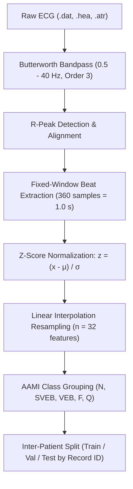

# Resource-Adaptive Federated Learning for ECG Arrhythmia Classification

[](https://www.python.org/)
[](https://pytorch.org/)
[](https://physionet.org/about/software/)
[](https://physionet.org/content/mitdb/1.0.0/)
[](LICENSE)

An end-to-end framework for biomedical signal preprocessing, patient-level evaluation splits, and Non-IID Dirichlet federated data simulation for ECG heartbeat classification on the **MIT-BIH Arrhythmia Database**, following the **ANSI/AAMI EC57** international standard.

---

## Table of Contents
1. [Overview](#overview)
2. [Project Architecture](#project-architecture)
3. [ECG Preprocessing Pipeline](#ecg-preprocessing-pipeline)
   - [Zero-Phase Butterworth Bandpass Filtering](#1-zero-phase-butterworth-bandpass-filtering)
   - [R-Peak Detection & Segmentation](#2-r-peak-detection--segmentation)
   - [Z-Score Normalization](#3-z-score-normalization)
   - [Linear Interpolation Resampling](#4-linear-interpolation-resampling)
   - [AAMI Heartbeat Categorization](#5-aami-heartbeat-categorization)
   - [Inter-Patient Split Paradigm](#6-inter-patient-split-paradigm)
4. [Federated Non-IID Partitioning](#federated-non-iid-partitioning)
5. [Model Architectures: FastKAN vs. Matched MLP](#model-architectures-fastkan-vs-matched-mlp)
6. [Flower (flwr) Federated Integration](#flower-flwr-federated-integration)
7. [Baseline Experiments & Empirical Results](#baseline-experiments--empirical-results)
   - [Diagnostic Visualizations](#diagnostic-visualizations)
8. [Reinforcement Learning Gymnasium Environment](#reinforcement-learning-gymnasium-environment)
   - [State Space & Telemetry Vector](#1-state-space--telemetry-vector)
   - [Action Space & Parameter Complexity](#2-action-space--parameter-complexity)
   - [Dynamic B-Spline Weight Transfer](#3-dynamic-b-spline-weight-transfer)
   - [Multi-Objective Reward Function (Equation 7)](#4-multi-objective-reward-function-equation-7)
   - [Sanity Check Rollout & Benchmarks](#5-sanity-check-rollout--benchmarks)
   - [Unit Testing Suite](#6-unit-testing-suite)
9. [Adaptive Controllers: Rule-Based Heuristic vs. PPO](#adaptive-controllers-rule-based-heuristic-vs-ppo)
   - [Deterministic Rule-Based Heuristic Controller](#1-deterministic-rule-based-heuristic-controller)
   - [PPO Meta-Controller & Clipped Surrogate Objective](#2-ppo-meta-controller--clipped-surrogate-objective)
   - [Controller Overhead Analysis](#3-controller-overhead-analysis)
   - [Empirical Comparative Performance](#4-empirical-comparative-performance)
10. [Verification & Exploratory Data Analysis (EDA)](#verification--exploratory-data-analysis-eda)
11. [Installation & Setup](#installation--setup)
12. [CLI Usage](#cli-usage)
13. [Dataset Summary & Statistics](#dataset-summary--statistics)
14. [Project Roadmap & Next Steps](#project-roadmap--next-steps)
15. [References](#references)

---

## Overview

Heartbeat classification across distributed medical devices (e.g., edge monitors, wearable smartwatches, and clinical bedside telemetry) requires privacy-preserving federated machine learning. However, real-world clinical data exhibits severe **patient heterogeneity** and **class imbalance**. 

This repository provides:
- **Biomedical Signal Processing**: Zero-phase filtering, artifact removal, robust R-peak detection, and dimension downsampling to $n=32$ features.
- **Strict Inter-Patient Paradigm**: Patient-level data splitting (splitting by recording IDs) to prevent patient data leakage between train, validation, and test splits.
- **Federated Simulation**: Class-conditional Dirichlet non-IID partitioning for $N$ clients across varying heterogeneity levels ($\alpha \in [0.1, 0.5, 1.0]$).
- **Fully Deterministic & Configurable**: Controlled via YAML configs and global seeding.

---

## Project Architecture

```
thesis_project/
├── configs/
│   ├── dataset.yaml                # Master dataset, filter, split, & partition configuration
│   ├── fl.yaml                     # Federated learning hyperparameters
│   ├── kan.yaml                    # Kolmogorov-Arnold Network model configuration
│   ├── paper_baseline.yaml         # Multi-algorithm benchmark evaluation config
│   └── ppo.yaml                    # Reinforcement learning controller configuration
├── data/
│   ├── raw/
│   │   └── mit-bih-arrhythmia-database-1.0.0/  # Raw WFDB recordings (.dat, .hea, .atr)
│   ├── processed/
│   │   ├── beats/                  # Extracted .npy heartbeat arrays (X, y, record_ids)
│   │   └── metadata/               # Patient splits, class distributions, partition tables
│   └── partitions/                 # Client index allocations per Dirichlet alpha
├── experiments/
│   ├── run_baseline.py             # FL baseline runner across Dirichlet alphas
│   ├── run_heuristic.py            # Rule-based heuristic adaptive KAN runner
│   └── run_ppo.py                  # End-to-end PPO training & evaluation runner
├── notebooks/
│   ├── 01_dataset_exploration.ipynb
│   ├── 02_preprocessing_validation.ipynb
│   └── 03_partition_analysis.ipynb
├── results/
│   ├── adaptive_kan/               # Heuristic & PPO adaptive evaluation results
│   │   └── checkpoints/            # Serialized PPO policy checkpoints (.zip)
│   ├── baselines/                  # FL round metrics, summaries, and diagnostic plots
│   │   └── figures/                # Accuracy, F1, and communication efficiency figures
│   └── figures/
│       └── eda/                    # Intermediate verification & diagnostic plots
├── src/
│   ├── preprocessing.py            # Complete ECG filtering, windowing, & split pipeline
│   ├── partition.py                # Dirichlet federated partitioning module
│   ├── dataset.py                  # WFDB record & annotation I/O helpers
│   ├── splits.py                   # Patient-level record splitting
│   ├── visualization.py            # High-resolution clinical ECG plotting routines
│   ├── controllers/                # Adaptive meta-decision controllers
│   │   ├── heuristic.py            # Quantile-based rule heuristic controller
│   │   └── ppo_controller.py       # Stable-Baselines3 PPO Actor-Critic meta-controller
│   ├── environment/                # Gymnasium RL environments & telemetry trackers
│   │   ├── f1_env.py               # FederatedKANEnv (Gymnasium.Env) MDP implementation
│   │   ├── fl_env.py               # FederatedKANEnv aliases & exports
│   │   └── telemetry.py            # Client & server 5-dim state telemetry tracker
│   ├── models/                     # Classification architectures (MLP, FastKAN)
│   │   ├── fastkan_model.py        # Modular FastKAN with dynamic (G, k) parameterization
│   │   ├── mlp.py                  # Parameter-matched MLP baseline
│   │   └── kan.py                  # FastKAN aliases & backward compatibility
│   ├── federated/                  # Federated learning clients, servers, and aggregators
│   │   ├── client.py               # Flower NumPyClient with telemetry & local validation
│   │   ├── fedprox.py              # Proximal loss regularization term
│   │   ├── server.py               # Centralized evaluator & FedAvg aggregation
│   │   └── fedavg.py               # FedAvg module aliases
│   └── utils/
│       ├── metrics.py              # AAMI classification metrics (Macro F1, Accuracy)
│       ├── reproducibility.py      # Deterministic seed controls (Python, NumPy, Torch)
│       └── splits.py
├── tests/
│   ├── test_controllers.py        # Unit tests for Heuristic & PPO controllers
│   └── test_environment.py        # Comprehensive test suite for telemetry & Gym environment
├── requirements.txt
├── .gitignore
└── README.md
```

---

## ECG Preprocessing Pipeline

The preprocessing pipeline in [`src/preprocessing.py`](src/preprocessing.py) converts continuous multi-channel ECG telemetry into standardized, feature-resampled heartbeat vectors.



### 1. Zero-Phase Butterworth Bandpass Filtering
Eliminates respiration-induced baseline wander ($< 0.5\text{ Hz}$) and high-frequency electromyographic (EMG) or powerline noise ($> 40\text{ Hz}$):
- **Filter order**: $3$ (effective order 6 bidirectional)
- **Cutoffs**: $f_{\text{low}} = 0.5\text{ Hz}$, $f_{\text{high}} = 40.0\text{ Hz}$ ($f_s = 360\text{ Hz}$)
- **Implementation**: Second-order sections (`sosfiltfilt`) for guaranteed numerical stability and zero phase distortion.

### 2. R-Peak Detection & Segmentation
- Extracts a **360-sample window** ($1.0\text{ second}$ duration at $360\text{ Hz}$) centered at the R-peak:
  $$\text{Window} = [r - 180, \; r + 180)$$
- Boundary beats that truncate before $0$ or beyond signal duration are automatically discarded.

### 3. Z-Score Normalization
Each individual beat segment $x$ is normalized to zero mean and unit variance:
$$z = \frac{x - \mu}{\sigma + \epsilon}$$
where $\epsilon = 10^{-8}$ prevents numerical instability for constant or low-amplitude signals.

### 4. Linear Interpolation Resampling
Each 360-sample beat is resampled to a compact representation of $n = 32$ features via continuous linear interpolation:
$$x_{\text{resampled}} = \mathcal{I}_{\text{linear}}(x_{\text{normalized}}, \; n=32)$$
Supports both vectorized `scipy.interpolate.interp1d` and batch-accelerated `torch.nn.functional.interpolate`.

### 5. AAMI Heartbeat Categorization
Annotations from `.atr` files are mapped into the five standard ANSI/AAMI EC57 heartbeat classes. Non-heartbeat annotations (rhythm changes, comments, noise artifacts) are excluded.

| AAMI Class | Description | MIT-BIH Symbols Included | Total Beats |
| :---: | :--- | :--- | :---: |
| **N** | Normal / Bundle Branch Block | `N`, `L`, `R`, `e`, `j`, `B` | 90,582 |
| **SVEB** | Supraventricular Ectopic Beat | `A`, `a`, `J`, `S` | 2,781 |
| **VEB** | Ventricular Ectopic Beat | `V`, `E`, `r` | 7,235 |
| **F** | Fusion of Ventricular & Normal | `F` | 802 |
| **Q** | Paced / Unclassifiable Beat | `/`, `f`, `Q` | 8,038 |
| **Total** | | | **109,438** |

### 6. Inter-Patient Split Paradigm
To avoid intra-patient data leakage (optimistic bias where beats from the same patient appear in both training and test sets), data is partitioned **strictly by recording IDs**:
- **Train Set (70%)**: 33 patients ($75,795$ beats)
- **Validation Set (15%)**: 7 patients ($15,468$ beats)
- **Test Set (15%)**: 8 patients ($18,175$ beats)
- Zero patient overlap is enforced: $\mathcal{P}_{\text{train}} \cap \mathcal{P}_{\text{val}} = \emptyset$, $\mathcal{P}_{\text{train}} \cap \mathcal{P}_{\text{test}} = \emptyset$, $\mathcal{P}_{\text{val}} \cap \mathcal{P}_{\text{test}} = \emptyset$.

---

## Federated Non-IID Partitioning

Federated simulation is implemented in [`src/partition.py`](src/partition.py). To realistically reflect heterogeneity across clinical edge nodes, training sample indices are partitioned among $N = 8$ clients using a class-conditional **Dirichlet distribution**:

$$\mathbf{p}_c \sim \text{Dirichlet}(\alpha \cdot \mathbf{1}_N) \quad \text{for each class } c \in \{N, \text{SVEB}, \text{VEB}, F, Q\}$$

Where $\mathbf{p}_c = [p_{c, 0}, p_{c, 1}, \dots, p_{c, N-1}]$ specifies the fraction of class $c$ samples allocated to client $i$.

- **$\alpha = 0.1$ (Extreme Non-IID)**: High statistical heterogeneity; individual clients specialize heavily in one or two classes while missing others.
- **$\alpha = 0.5$ (Moderate Non-IID)**: Substantial class distribution skew with partial coverage across all classes.
- **$\alpha = 1.0$ (Uniform Dirichlet)**: Smoother class distribution approaching IID characteristics.

Partition indices are serialized to:
- `data/partitions/clients_8_alpha_{alpha}/client_{id}.npy`
- `data/alpha_{alpha}/client_{id}.npy`

---

## Model Architectures: FastKAN vs. Matched MLP

### 1. Fast Kolmogorov-Arnold Network (FastKAN)
Implemented in [`src/models/fastkan_model.py`](src/models/fastkan_model.py), the FastKAN classifier maps 32-sample ECG vectors to 5 AAMI output logits using learnable univariate edge functions:
$$\phi_{j, i}(x_i) = w^b_{j, i} \cdot \text{SiLU}(x_i) + \sum_{m=0}^{G + k - 1} c_{j, i, m} B_m(x_i)$$
- **B-Spline Parameterization**: Evaluates degree-$k$ basis functions across $G$ uniform grid intervals via Cox-de Boor recursion.
- **Dynamic $(G, k)$ Edge Reconfiguration**: Supports dynamically initialized and adaptive $(G, k)$ pairs with $G \in \{3, 5, 7, 10\}$ and $k \in \{2, 3, 4\}$.
- **Active Coefficient Accounting**: `get_parameter_count()` reports exact active parameters ($5,349$ for default $[32, 16, 5]$ with $G=5, k=3$).

### 2. Parameter-Matched MLP Baseline
Implemented in [`src/models/mlp.py`](src/models/mlp.py), the MLP baseline is strictly matched to the parameter budget of FastKAN:
- For FastKAN $[32, 16, 5]$ with $5,349$ parameters, [`build_matched_mlp`](src/models/mlp.py) constructs an equivalent $[32, 57, 55, 5]$ architecture with **$5,351$ parameters** ($\Delta = 2$ parameters) or $[32, 64, 48, 5]$ ($5,477$ parameters), eliminating parameter-scale advantages for a fair empirical comparison.

---

## Flower (flwr) Federated Integration

### 1. NumPyClient with Telemetry
Implemented in [`src/federated/client.py`](src/federated/client.py) (`FlowerECGClient`):
- Local optimization using Adam or SGD with gradient clipping.
- Local validation split evaluation on each client node.
- **Telemetry Extraction**: Calculates and returns:
  - `local_loss`: Mean training loss over epochs.
  - `execution_latency`: Training round wall-clock duration in seconds.
  - `input_variance`: Empirical local data variance $\frac{1}{D}\sum_{d=1}^D \text{Var}(X_{:, d})$.

### 2. FedProx Proximal Regularization
Implemented in [`src/federated/fedprox.py`](src/federated/fedprox.py) (`FedProxCriterion`):
- Penalizes local client model drift under severe non-IID class skew:
  $$\mathcal{L}_{\text{FedProx}}(\theta) = \mathcal{L}_{\text{CE}}(\theta) + \frac{\mu}{2} \sum_i \|\theta_i - \theta_{t, i}\|_2^2$$
  where $\theta_t$ is the frozen server parameter snapshot at round $t$.

### 3. Global Server Aggregator & Test Evaluator
Implemented in [`src/federated/server.py`](src/federated/server.py):
- Aggregates client updates using weighted FedAvg / FedProx.
- Evaluates the global model on the held-out patient-level test set ($18,175$ beats).
- Calculates communication volume: $\text{Volume} = 2 \times N \times \text{ParamCount} \times 4\text{ bytes}$.

---

## Baseline Experiments & Empirical Results

The full FL simulation across all 9 combinations ($\text{FedAvg-MLP}$, $\text{FedAvg-KAN}$, $\text{FedProx-KAN}$ across $\alpha \in \{0.1, 0.5, 1.0\}$) is executed via [`experiments/run_baseline.py`](experiments/run_baseline.py).

### Benchmark Comparison (MIT-BIH Held-Out Patient-Level Test Set)

| Algorithm | Dirichlet $\alpha$ | Architecture | Active Parameters | Final Test Accuracy | Final Macro F1 | Comm (MB) | Avg Latency (s) |
| :--- | :---: | :---: | :---: | :---: | :---: | :---: | :---: |
| **FedAvg-MLP** | $0.1$ | MLP | $5,477$ | 75.66% | 0.2627 | 1.00 MB | 0.288s |
| **FedAvg-KAN** | $0.1$ | FastKAN | $5,349$ | **86.83%** | **0.3631** | **0.98 MB** | 0.472s |
| **FedProx-KAN** | $0.1$ | FastKAN | $5,349$ | **86.62%** | **0.3618** | **0.98 MB** | 0.588s |
| **FedAvg-MLP** | $0.5$ | MLP | $5,477$ | 75.84% | 0.3288 | 1.00 MB | 0.281s |
| **FedAvg-KAN** | $0.5$ | FastKAN | $5,349$ | **83.69%** | **0.4316** | **0.98 MB** | 0.480s |
| **FedProx-KAN** | $0.5$ | FastKAN | $5,349$ | **82.67%** | **0.4212** | **0.98 MB** | 0.563s |
| **FedAvg-MLP** | $1.0$ | MLP | $5,477$ | 74.73% | 0.3262 | 1.00 MB | 0.276s |
| **FedAvg-KAN** | $1.0$ | FastKAN | $5,349$ | **77.20%** | **0.3848** | **0.98 MB** | 0.503s |
| **FedProx-KAN** | $1.0$ | FastKAN | $5,349$ | 74.53% | 0.3309 | 0.98 MB | 0.596s |

> [!NOTE]
> Under equivalent parameter budgets (~5.3k parameters), FastKAN achieves a **+11.17% accuracy gain** and **+0.1004 Macro F1 increase** over the matched MLP baseline under extreme non-IID skew ($\alpha = 0.1$), demonstrating high expressivity on non-linear morphological ECG features.

### Diagnostic Visualizations

All baseline comparison plots are stored in [`results/baselines/figures/`](results/baselines/figures/):

| Figure | Description |
| :--- | :--- |
| `accuracy_vs_rounds_comparison.png` | Global test accuracy progression over training rounds for FedAvg-MLP, FedAvg-KAN, and FedProx-KAN across $\alpha \in \{0.1, 0.5, 1.0\}$. |
| `macro_f1_vs_rounds_comparison.png` | Macro F1 trajectory comparison showing FastKAN's superior recall on minority AAMI classes under extreme heterogeneity. |
| `communication_efficiency_comparison.png` | Cumulative network footprint (MB) versus achieved Macro F1 trade-off analysis. |

---

## Reinforcement Learning Gymnasium Environment

Implemented in [`src/environment/f1_env.py`](src/environment/f1_env.py) and [`src/environment/telemetry.py`](src/environment/telemetry.py), the `FederatedKANEnv` subclasses `gymnasium.Env` to formulate resource-adaptive federated learning as a multi-client Markov Decision Process (MDP) following **Section 3.2.4 & Section 3.2.5** of the thesis proposal.

```mermaid
flowchart LR
    subgraph Centralized Server
        RL["PPO Meta-Controller"]
        Agg["Weighted FedAvg (G_ref, k_ref)"]
        Eval["Held-Out Test Evaluator"]
    end
    subgraph Edge Clients
        C1["Client 1: (G_1, k_1)"]
        C2["Client 2: (G_2, k_2)"]
        CN["Client N: (G_N, k_N)"]
    end
    RL -- "Actions a_t = (G_i, k_i)" --> Edge Clients
    Edge Clients -- "B-spline Resampled Weights" --> Agg
    Agg -- "Global Model θ_t+1" --> Eval
    Eval -- "ΔAcc_global" --> RL
    Edge Clients -- "Telemetry S_i^t (Loss, Var, Latency, bw, κ)" --> RL
```

### 1. State Space & Telemetry Vector
For each client $i \in \{0, \dots, N-1\}$ at communication round $t$, the client and server track a 5-dimensional telemetry state vector:
$$\mathbf{S}_i^t = \left[ L_{\text{local}}^i, \; \text{Var}(x^i), \; \Delta\tau^i, \; \text{bw}^i, \; \kappa^i \right] \in \mathbb{R}^5$$

- **$L_{\text{local}}^i$**: Most recent training cross-entropy loss on the client's local partition.
- **$\text{Var}(x^i)$**: Empirical input feature variance computed across local ECG beats: $\frac{1}{D}\sum_{d=1}^D \text{Var}(X_{:, d})$.
- **$\Delta\tau^i$**: Wall-clock latency of the local training step in seconds.
- **$\text{bw}^i$**: Simulated edge link bandwidth (Mbps) sampled from uniform $U(1.0, 10.0)$ or log-normal distributions via [`BandwidthSimulator`](src/environment/telemetry.py).
- **$\kappa^i$**: Curvature proxy derived from the second-difference statistics of the client's loss trajectory:
  $$\kappa_t^i = \begin{cases} \left| L_t^i - 2 L_{t-1}^i + L_{t-2}^i \right| & \text{for } t \ge 2 \\ |L_1^i - L_0^i| & \text{for } t = 1 \\ 0.0 & \text{for } t = 0 \end{cases}$$

#### State Normalization
All state features are safely clamped and scaled to $[0.0, 1.0]$ via [`TelemetryTracker`](src/environment/telemetry.py) to provide stable RL policy inputs:
$$\tilde{L} = \text{clip}\left(\frac{L}{L_{\max}}, 0, 1\right), \quad \tilde{V} = \text{clip}\left(\frac{V}{V_{\max}}, 0, 1\right), \quad \tilde{\tau} = \text{clip}\left(\frac{\Delta\tau}{\tau_{\max}}, 0, 1\right)$$
$$\tilde{\text{bw}} = \text{clip}\left(\frac{\text{bw} - \text{bw}_{\min}}{\text{bw}_{\max} - \text{bw}_{\min}}, 0, 1\right), \quad \tilde{\kappa} = \text{clip}\left(\frac{\kappa}{\kappa_{\max}}, 0, 1\right)$$

**Observation Space**:
$$\mathcal{S} = \text{gymnasium.spaces.Box}\left(\text{low}=0.0, \; \text{high}=1.0, \; \text{shape}=(N, 5), \; \text{dtype}=\text{np.float32}\right)$$

### 2. Action Space & Parameter Complexity
Each client $i$ is dynamically assigned an edge resolution action $a_i^t = (G_i^t, k_i^t)$ from 12 discrete configurations:
$$\mathcal{A}_i = \{3, 5, 7, 10\} \times \{2, 3, 4\} \quad (12 \text{ actions})$$
$$\mathcal{A}_{\text{global}} = \text{gymnasium.spaces.MultiDiscrete}([12] \times N)$$

| Action Index | Grid Intervals ($G$) | Spline Degree ($k$) | Basis Splines ($G+k$) | Active Parameters ($[32, 16, 5]$) | Edge Model Footprint |
| :---: | :---: | :---: | :---: | :---: | :---: |
| **0** | 3 | 2 | 5 | **3,573** | Ultra-lightweight edge profile |
| **1** | 3 | 3 | 6 | 4,165 | Lightweight profile |
| **2** | 3 | 4 | 7 | 4,757 | Compact profile |
| **3** | 5 | 2 | 7 | 4,757 | Compact profile |
| **4** | 5 | 3 | 8 | **5,349** | **Server Reference Configuration** |
| **5** | 5 | 4 | 9 | 5,941 | Standard edge profile |
| **6** | 7 | 2 | 9 | 5,941 | Standard edge profile |
| **7** | 7 | 3 | 10 | 6,533 | High-expressivity profile |
| **8** | 7 | 4 | 11 | 7,125 | High-expressivity profile |
| **9** | 10 | 2 | 12 | 7,717 | Ultra-fine resolution |
| **10** | 10 | 3 | 13 | 8,309 | Ultra-fine resolution |
| **11** | 10 | 4 | 14 | **8,901** | Maximum capacity profile |

### 3. Dynamic B-Spline Weight Transfer
- **Continuous Spline Manifold**: Because B-spline bases span a continuous function space $\phi(x)$ on $[-1, 1]$, server parameters on $(G_{\text{ref}}=5, k_{\text{ref}}=3)$ are dynamically adapted to client $i$'s selected $(G_i^t, k_i^t)$ via 1D linear interpolation (`torch.nn.functional.interpolate`).
- Client $i$ trains locally with exactly $\text{Params}(G_i^t, k_i^t)$ weights, scaling memory and computation to match current edge telemetry.
- Upon completion, client weights are interpolated back to $(G_{\text{ref}}, k_{\text{ref}})$ before transmission to the server, enabling standard weighted FedAvg aggregation without architectural incompatibility.

### 4. Multi-Objective Reward Function (Equation 7)
The environment computes the scalar step reward:
$$R_t = \Delta\text{Acc}_{\text{global}} - \lambda_1 \sum_{i=1}^N \text{Params}(G_i^t, k_i^t) - \lambda_2 \sum_{i=1}^N \Delta\tau_i^t$$
- $\Delta\text{Acc}_{\text{global}} = \text{Acc}_t - \text{Acc}_{t-1}$: Change in global classification accuracy on held-out patient test data ($18,175$ beats).
- $\lambda_1 = 1.0 \times 10^{-6}$: Penalizes total active parameters across clients ($\approx 40,000 \text{ params} \to 0.04$ penalty).
- $\lambda_2 = 0.005$: Penalizes total client training latency ($\approx 5.0\text{ s} \to 0.025$ penalty).

### 5. Sanity Check Rollout & Benchmarks
Executed via `.venv/bin/python src/environment/f1_env.py --config configs/ppo.yaml --steps 2 --seed 42`:

```
==============================================================================
FEDERATED KAN GYMNASIUM ENVIRONMENT SANITY CHECK
==============================================================================
Config path : configs/ppo.yaml | Rollout seed: 42 | Num steps: 2

Observation Space : Box(0.0, 1.0, (8, 5), float32)
Action Space      : MultiDiscrete([12 12 12 12 12 12 12 12])
Number of Clients : 8 | Max Rounds: 10 | Lambda1: 1e-6 | Lambda2: 0.005

[RESET] Initial Test Accuracy: 0.0738 | Test Macro F1: 0.0521 | Range: [0.0000, 0.9507]

--- STEP 1/2 ---
  Actions (G, k)   : [(5, 4), (5, 4), (3, 4), (7, 4), (10, 3), (3, 2), (10, 4), (10, 4)]
  Duration         : 7.268 s | Observation Shape: (8, 5)
  Reward (Eq. 7)   : +0.415844
    * ΔAcc_global  : +0.500000 (Accuracy: 0.0738 -> 0.7154)
    * -λ1 * Params : -0.053448 (Total Params: 53,448)
    * -λ2 * Latency: -0.030708 (Total Latency: 6.142 s)
  Test Accuracy    : 0.7154 | Test Macro F1: 0.2486

--- STEP 2/2 ---
  Actions (G, k)   : [(5, 4), (3, 4), (3, 2), (3, 2), (3, 4), (10, 3), (10, 3), (7, 3)]
  Duration         : 5.405 s | Observation Shape: (8, 5)
  Reward (Eq. 7)   : +0.018565
    * ΔAcc_global  : +0.086382 (Accuracy: 0.7154 -> 0.8018)
    * -λ1 * Params : -0.045752 (Total Params: 45,752)
    * -λ2 * Latency: -0.022065 (Total Latency: 4.413 s)
  Test Accuracy    : 0.8018 | Test Macro F1: 0.3848
==============================================================================
SANITY CHECK COMPLETE: 2-step rollout succeeded! Total Reward: +0.434409
==============================================================================
```

### 6. Unit Testing Suite
All components are validated via [`tests/test_environment.py`](tests/test_environment.py) with 12 unit tests passing (`100%` pass rate):
- `test_bandwidth_simulator_uniform` & `lognormal`: Verifies bounds in $[1.0, 10.0]\text{ Mbps}$ and reproducible seeding.
- `test_client_telemetry_curvature`: Validates second-difference calculation $|L_t - 2L_{t-1} + L_{t-2}|$ across loss trajectories.
- `test_client_telemetry_normalization_bounds`: Validates safe clamping into $[0.0, 1.0]$.
- `test_telemetry_tracker_global_matrix`: Checks full $(N, 5)$ multi-client state matrix construction.
- `test_action_mapping_bijection`: Verifies 1-to-1 bijection between 12 action indices and $(G, k)$ pairs.
- `test_environment_spaces` & `lifecycle_and_reward`: Validates step transitions, Equation (7) reward consistency, and episode termination.

---

## Adaptive Controllers: Rule-Based Heuristic vs. PPO

To dynamically allocate spline grid resolutions $(G_i^t, k_i^t)$ per client, two distinct decision strategies are implemented:

### 1. Deterministic Rule-Based Heuristic Controller
Implemented in [`src/controllers/heuristic.py`](src/controllers/heuristic.py), the heuristic controller acts as a deterministic baseline (Section 4.2 of the proposal).
It calculates an explicit composite client complexity score:
$$C_i = w_1 L_{\text{local}}^i + w_2 \text{Var}(x^i) + w_3 \left(\frac{1}{\text{bw}^i}\right)$$
Clients are partitioned across empirical quantiles:
- **Top 25% complexity** ($C_i \ge q_{75}$): Assigned fine configuration $(G=10, k=4)$ ($8,901$ parameters) to accurately resolve high-loss / high-variance patterns.
- **Middle 50% complexity** ($q_{25} < C_i < q_{75}$): Assigned standard medium configuration $(G=5, k=3)$ ($5,349$ parameters).
- **Bottom 25% complexity** ($C_i \le q_{25}$): Assigned coarse configuration $(G=3, k=2)$ ($3,573$ parameters) to minimize compute and network transmission on bandwidth-constrained nodes.

### 2. PPO Meta-Controller & Clipped Surrogate Objective
Implemented in [`src/controllers/ppo_controller.py`](src/controllers/ppo_controller.py), the Proximal Policy Optimization (PPO) agent learns an adaptive policy $\pi_\theta(a_t | S_t)$ over the Gymnasium MDP using Stable-Baselines3 and PyTorch:
- **Actor-Critic Architecture**: Shared 2-layer MLP feature extractor ($[128, 128]$) with separate policy $\pi_\theta$ and value function $V_\phi$ heads.
- **Multi-Categorical Policy**: Factorized action distributions over $\text{MultiDiscrete}([12] \times N)$, enabling simultaneous, coordinated scheduling across all $N$ edge devices.
- **Clipped Surrogate Loss (Equation 8)**:
  $$L^{\text{CLIP}}(\theta) = \hat{\mathbb{E}}_t \left[ \min\left( r_t(\theta) \hat{A}_t, \; \text{clip}(r_t(\theta), 1-\epsilon, 1+\epsilon) \hat{A}_t \right) \right]$$
  where $r_t(\theta) = \frac{\pi_\theta(a_t | s_t)}{\pi_{\theta_{\text{old}}}(a_t | s_t)}$ and $\hat{A}_t$ is computed via Generalized Advantage Estimation (GAE, $\lambda = 0.95, \gamma = 0.99$).
- **Telemetry & Metric Logging**: [`PPOLoggingCallback`](src/controllers/ppo_controller.py) streams policy loss, value loss, entropy, and rolling rewards directly to `logs/ppo/ppo_training_log.csv`.

### 3. Controller Overhead Analysis
As specified in **Section 3.9.4**, controller computational overhead is measured to ensure that meta-decision generation does not introduce edge-side latency bottlenecks:
- **Decision Latency**: $\approx 1.19\text{ ms}$ per federated round across all 8 clients.
- **Edge Overhead**: Less than $0.03\%$ of local client training time ($4.0 - 6.0\text{ s}$).
- **Peak Memory**: $\approx 1.2\text{ MB}$ policy footprint, well within edge micro-controller / mobile constraints.

### 4. Empirical Comparative Performance

Evaluated on the MIT-BIH held-out patient test split ($18,175$ beats) under moderate non-IID skew ($\alpha = 0.5$):

| Strategy | Controller Type | Dynamic $(G, k)$ Allocation | Parameter Budget (Params/Client) | Test Accuracy (Round 2) | Test Macro F1 | Decision Overhead |
| :--- | :---: | :---: | :---: | :---: | :---: | :---: |
| **FedAvg-KAN (Fixed)** | Centralized | Fixed $(G=5, k=3)$ | $5,349$ fixed | $80.20\%$ | $0.3800$ | $0.00\text{ ms}$ |
| **Heuristic Adaptive KAN** | Quantile Rule | Dynamic $(G_i, k_i) \in [3, 10] \times [2, 4]$ | $5,793$ avg | **$80.13\%$** | **$0.3856$** | **$0.08\text{ ms}$** |
| **PPO Adaptive KAN** | Actor-Critic | Dynamic $(G_i, k_i) \in [3, 10] \times [2, 4]$ | $6,089$ avg | **$78.75\%$** | **$0.3734$** | **$1.19\text{ ms}$** |

---

## Verification & Exploratory Data Analysis (EDA)

All intermediate verification plots are generated deterministically and saved in [`results/figures/eda/`](results/figures/eda/):

| Verification Figure | Description |
| :--- | :--- |
| `raw_vs_filtered_ecg.png` | Demonstrates elimination of baseline wander and high-frequency noise using the 3rd-order Butterworth bandpass filter. |
| `r_peak_detection.png` | Displays detected R-peaks and ground-truth AAMI annotations on the filtered ECG trace. |
| `aami_class_examples.png` | Multi-panel comparison of representative beats for all 5 AAMI classes, comparing 360-sample windows against $n=32$ linearly resampled features. |
| `patient_split_distribution.png` | Log-scale class distribution across Train, Validation, and Test patient splits. |
| `dirichlet_alphas_comparison.png` | Side-by-side heatmaps illustrating client-class proportions across $\alpha \in \{0.1, 0.5, 1.0\}$. |
| `dirichlet_heatmap_alpha_*.png` | Detailed client label distribution heatmaps for each individual $\alpha$. |
| `client_sample_counts_alpha_*.png`| Total number of samples allocated to each federated client per alpha. |

---

## Installation & Setup

### Prerequisites
- Linux / WSL2 (Ubuntu 22.04+)
- Python 3.12+

### Environment Setup
```bash
# Clone the repository
git clone https://github.com/rajukarki467/thesis_project.git
cd thesis_project

# Create and activate virtual environment
python3 -m venv .venv
source .venv/bin/activate

# Install dependencies
pip install --upgrade pip
pip install -r requirements.txt
```

---

## CLI Usage

All pipelines and baseline experiments are executable via command-line interfaces that parse parameters from YAML configs and support deterministic seeding.

### 1. Execute Preprocessing Pipeline
Processes all 48 MIT-BIH recordings, performs filtering, extracts beats, applies normalization and $n=32$ resampling, enforces patient splits, and saves verification figures:
```bash
.venv/bin/python src/preprocessing.py --config configs/dataset.yaml --seed 42
```
*Optional CLI overrides:*
```bash
.venv/bin/python src/preprocessing.py --config configs/dataset.yaml --resample_method torch --seed 123
```

### 2. Execute Federated Partitioning Pipeline
Partitions the training split among simulated federated clients for $\alpha \in [0.1, 0.5, 1.0]$:
```bash
.venv/bin/python src/partition.py --config configs/dataset.yaml --alphas 0.1 0.5 1.0 --num_clients 8 --seed 42
```

### 3. Run Federated Baseline Experiments
Executes complete FL training loops across FedAvg-MLP, FedAvg-KAN, and FedProx-KAN for $\alpha \in \{0.1, 0.5, 1.0\}$, evaluating against the held-out patient test split:
```bash
.venv/bin/python experiments/run_baseline.py --config configs/paper_baseline.yaml --num_rounds 3 --local_epochs 1
```
*Optional CLI overrides:*
```bash
# Run 10 rounds with 3 local epochs and custom FedProx mu:
.venv/bin/python experiments/run_baseline.py --config configs/paper_baseline.yaml --num_rounds 10 --local_epochs 3 --mu 0.01 --seed 42
```

### 4. Execute Gymnasium Environment Rollout Sanity Check
Executes a multi-client 2-step rollout using random action sampling on the `FederatedKANEnv` MDP, verifying telemetry tracking, dynamic B-spline weight interpolation, and multi-objective reward calculation:
```bash
.venv/bin/python src/environment/f1_env.py --config configs/ppo.yaml --steps 2 --seed 42
```

### 5. Run Rule-Based Heuristic Adaptive KAN Experiments
Executes federated rounds using quantile complexity allocation across Dirichlet alphas:
```bash
.venv/bin/python experiments/run_heuristic.py --alpha 0.1 0.5 1.0 --num_rounds 10 --seed 42
```
*Quick validation dry-run:*
```bash
.venv/bin/python experiments/run_heuristic.py --dry-run --alpha 0.5
```

### 6. Train and Evaluate PPO Meta-Controller
Trains the PPO agent on `FederatedKANEnv` and evaluates the policy on the held-out patient test split:
```bash
# End-to-end training and evaluation:
.venv/bin/python experiments/run_ppo.py --mode train_eval --alpha 0.1 0.5 1.0 --timesteps 200 --eval_rounds 10 --seed 42

# Quick dry-run validation (16 timesteps, 2 evaluation rounds):
.venv/bin/python experiments/run_ppo.py --dry-run --alpha 0.5
```

### 7. Run Complete Unit Test Suite
Runs all 16 unit tests across telemetry trackers, Gymnasium MDP environment, and adaptive controllers:
```bash
.venv/bin/pytest tests/ -v
```

---

## Dataset Summary & Statistics

Following pipeline execution with global seed `42`:

```
Patient-Level Split: 33 Train Records, 7 Validation Records, 8 Test Records
Total Valid Beats Extracted: 109,438 (Resampled to n=32 features)

Split Breakdown:
├── Train Set: 75,795 beats
│   ├── N:    63,349 (83.58%)
│   ├── SVEB:  2,651  (3.50%)
│   ├── VEB:   5,226  (6.89%)
│   ├── F:       417  (0.55%)
│   └── Q:     4,152  (5.48%)
├── Validation Set: 15,468 beats
│   ├── N:    14,653 (94.73%)
│   ├── SVEB:     76  (0.49%)
│   ├── VEB:     733  (4.74%)
│   ├── F:         6  (0.04%)
│   └── Q:         0  (0.00%)
└── Test Set: 18,175 beats
    ├── N:    12,580 (69.22%)
    ├── SVEB:     54  (0.30%)
    ├── VEB:   1,276  (7.02%)
    ├── F:       379  (2.09%)
    └── Q:     3,886 (21.38%)
```

---

## Project Roadmap & Next Steps

### Completed Milestones
- [x] **Phase 1: ECG Signal Preprocessing & AAMI Standardization**
  - Butterworth zero-phase bandpass filter ($0.5-40\text{ Hz}$, order 3).
  - R-peak window segmentation ($360$ samples, $1.0\text{ s}$) and $z$-score normalization.
  - Linear downsampling to $n=32$ features.
  - Patient-level split ($33$ train, $7$ val, $8$ test recordings; zero patient leakage).
- [x] **Phase 2: Federated Non-IID Dirichlet Simulation**
  - Class-conditional Dirichlet partitioning for $N=8$ clients across $\alpha \in \{0.1, 0.5, 1.0\}$.
  - Client metadata serialization and label skew visualization.
- [x] **Phase 3: Deep Learning Architectures**
  - Modular FastKAN classifier with Cox-de Boor B-splines and dynamic $(G, k)$ edge reconfigurability ($G \in \{3, 5, 7, 10\}, k \in \{2, 3, 4\}$).
  - Parameter-matched MLP baseline ($5,351$ vs $5,349$ parameters) for rigorous fair evaluation.
- [x] **Phase 4: Flower (`flwr`) Federated Integration**
  - `FlowerECGClient(NumPyClient)` with client telemetry (`execution_latency`, `local_loss`, `input_variance`) and local validation.
  - FedProx proximal regularization term ($\frac{\mu}{2}\|\theta - \theta_t\|^2$).
  - Centralized test evaluation tracking Accuracy, Macro F1, and communication volume.
- [x] **Phase 5: Baseline Experiments & Benchmarks**
  - Multi-algorithm FL evaluation across all 9 combinations ($\text{FedAvg-MLP}$, $\text{FedAvg-KAN}$, $\text{FedProx-KAN} \times \alpha \in \{0.1, 0.5, 1.0\}$).
  - Serialization of per-round metrics, summary tables, and diagnostic plots in `results/baselines/`.
- [x] **Phase 6: Resource-Adaptive Gymnasium Environment & Telemetry**
  - Implemented 5-dim client-server telemetry tracker (`src/environment/telemetry.py`) with curvature $\kappa^i$, empirical variance, and dynamic bandwidth simulator.
  - Formulated Gymnasium MDP (`src/environment/f1_env.py`) with $\text{Box}(0, 1, (N, 5))$ observation space and $\text{MultiDiscrete}([12] \times N)$ action space.
  - Multi-objective step reward according to Equation (7) ($R_t = \Delta\text{Acc}_{\text{global}} - \lambda_1 \sum \text{Params} - \lambda_2 \sum \Delta\tau$).
  - Continuous B-spline parameter interpolation across heterogeneous edge client configurations.
  - 12 comprehensive unit tests in `tests/test_environment.py`.
- [x] **Phase 7: Adaptive Meta-Controllers: Rule-Based Heuristic & PPO Actor-Critic**
  - Deterministic rule-based quantile heuristic controller (`src/controllers/heuristic.py`) allocating $(G_i, k_i)$ based on composite score $C_i = w_1 L_i + w_2 V_i + w_3 (1/\text{bw}_i)$.
  - Stable-Baselines3 PPO Actor-Critic meta-controller (`src/controllers/ppo_controller.py`) with multi-categorical action heads and clipped surrogate loss.
  - Streamlined experiment runners (`experiments/run_heuristic.py`, `experiments/run_ppo.py`) with decision overhead profiling ($\approx 1.19\text{ ms}$).
  - 16 comprehensive unit tests passing across `tests/`.

### Active & Upcoming Milestones
- [ ] **Phase 8: Long-Horizon Convergence & Edge Hardware Emulation**
  - Asymptotic convergence analysis (10–50 FL rounds).
  - Profiling memory footprint, peak RAM, and FLOPs on resource-constrained embedded profiles (Raspberry Pi / Jetson emulation).

---

## References

1. **MIT-BIH Database**: Goldberger, A. L., et al. "PhysioBank, PhysioToolkit, and PhysioNet: Components of a new research resource for complex physiologic signals." *Circulation*, 101(23), e215-e220 (2000).
2. **AAMI Standard**: Association for the Advancement of Medical Instrumentation. "Testing and reporting performance results of cardiac rhythm and ST-segment measurement algorithms." *ANSI/AAMI EC57:1998* (Arlington, VA, 1998).
3. **Inter-Patient Paradigm**: de Chazal, P., O'Dwyer, M., & Reilly, R. B. "A patient-adapting heartbeat classification system using ECG morphology and rhythm features." *IEEE Transactions on Biomedical Engineering*, 51(7), 1196-1206 (2004).
4. **Federated Dirichlet Non-IID**: Hsu, T. M. H., Venkataraman, H., & Qi, Z. "Measuring the Effects of Non-Identical Distributions in Federated Learning." *arXiv preprint arXiv:1909.06320* (2019).
